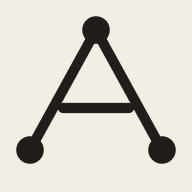

<p align="center">
  
</p>

<h1 align="center">Tag Atlas</h1>

<p align="center">
  A local-first, read-only map of an Obsidian Zettelkasten.<br>
  Tag hierarchy, note memberships, curation gaps, and cross-category bridges — in one legible atlas.
</p>

Tag Atlas is not another force-directed graph of every note. It treats your tag notes and `#index` notes as the structure they already are, then makes that structure visible and navigable.

- **Atlas** — tags as a hierarchy, content notes as memberships, one sliding port per tag for every edge.
- **Index** — all notes grouped by lifecycle status, with home, curation, and paths.
- **Bridges** — notes spanning multiple non-meta categories.
- **External sources** — `#external` notes are a type, not a maturity stage: pink ring, dedicated Index group, no unfiled/no maturity count.
- **Search** — `Ctrl+O` / `⌘O` / `/` quick switch over tags and notes.
- **Live update** — save a note in Obsidian; open tabs re-render.
- **Local only** — no accounts, no cloud, no telemetry, no vault writes.

## Requirements

- Python 3.10+
- A modern browser
- An Obsidian vault whose tag notes follow the conventions below
- No Node.js, package manager, or build step

## Quick start

```bash
git clone https://github.com/mqf080-bit/Atlas-Zettelkasten.git
cd Atlas-Zettelkasten/app
./start.sh
```

`start.sh`:

1. starts the local server and vault watcher,
2. asks for the vault path on first run,
3. opens the browser.

The first-run prompt stores the absolute vault path in `app/.atlas-config.json` (ignored by Git). The vault itself is **never written to**.

Headless:

```bash
./start.sh --no-open
```

Normally the app is at <http://127.0.0.1:4173/>. If that port is occupied, `start.sh` prints the fallback URL.

## How it reads the vault

Tag Atlas does not rely on frontmatter. It reads the same wikilinks you already use:

```markdown
Status: #5th

Tags:
[[Machine Learning]]
[[AI]]
[[Python]]
```

- Tag notes live in `3. Tags/`.
- A tag note marked `#index` can link to child tag notes and/or content notes.
- A content note links to the tag notes it belongs to.
- A note's **home** is the curating index, or the most specific index it links, or its broadest inherited index parent.
- If a note links both a parent and a child tag, the parent becomes `inherited` and does not double-count as a direct membership.

The full rules — index semantics, home selection, ancestor collapse, statuses, curation, meta tags, and bridges — are in **[docs/VAULT_CONVENTION.md](docs/VAULT_CONVENTION.md)**.

## Repository layout

```text
README.md                 product overview
docs/
  VAULT_CONVENTION.md     how to structure and link a vault
  SETUP.md                install, run, configure, troubleshoot
  ARCHITECTURE.md         data flow, modules, APIs, design decisions
app/
  index.html              app shell
  app.js                  state, views, graph, interactions
  app.css                 app layout and interaction styles
  styles.css              design tokens and base components
  model.js                tag tree / home / linked / bridges
  layout.js               seeds and force defaults
  render.js               rings, bars, badges, escaping
  build_snapshot.py       read-only vault -> snapshot
  serve.py                local server, config API, watcher, shutdown
  watch.py                standalone snapshot watcher
  start.sh                one-command launcher
  logo.svg / logo-192.png mark and favicon
  data/synthetic.json     optional synthetic demo fixture
tag-atlas-brief.md        product/semantic decisions
visual-system.md          visual grammar and tokens
```

`app/data/vault.json`, `app/screens/`, and `app/.atlas-config.json` are intentionally **not committed**: they contain or derive from a private vault.

## Design notes

- Warm paper / warm charcoal, 1px hairlines, 2px radii, no gradients or shadows.
- Status is the only chromatic channel.
- Solid index-tree edges are stepped 90° traces; shared-note links are dotted annotations with zero spring force.
- The canvas is unbounded and has no minimap.
- Hover fills are translucent; active/selected fills remain solid.

See **[visual-system.md](visual-system.md)** and **[tag-atlas-brief.md](tag-atlas-brief.md)**.

## Privacy

- Tag Atlas runs on `127.0.0.1`.
- It reads the vault; it does not rename, rewrite, or create notes.
- Generated snapshots and local config are git-ignored.
- The only outbound action is `obsidian://open` when you explicitly click an Obsidian button.
- No analytics, remote fonts, or third-party requests.

## Status and limitations

Usable as a local app. Not an Obsidian plugin yet.

- No note editing, index rewriting, or vault writes.
- No mobile/touch-specific gestures.
- Quick switch is path/title-ranked, not full-text fuzzy.
- Camera and node positions are in-memory; theme, force values, and Bridges grouping persist locally.
- The plugin port would require a substantial view/interaction rewrite; the model and layout are reusable.

Setup details, API endpoints, and troubleshooting: **[docs/SETUP.md](docs/SETUP.md)**.  
Architecture and data flow: **[docs/ARCHITECTURE.md](docs/ARCHITECTURE.md)**.

## License

MIT. See [LICENSE](LICENSE).
